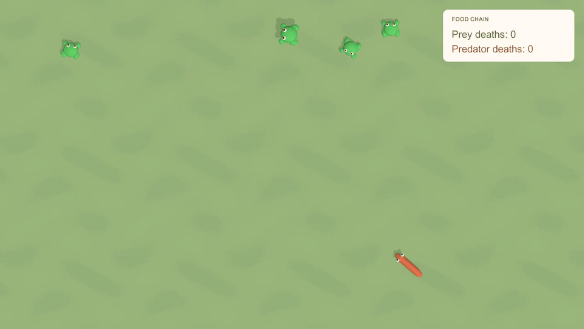
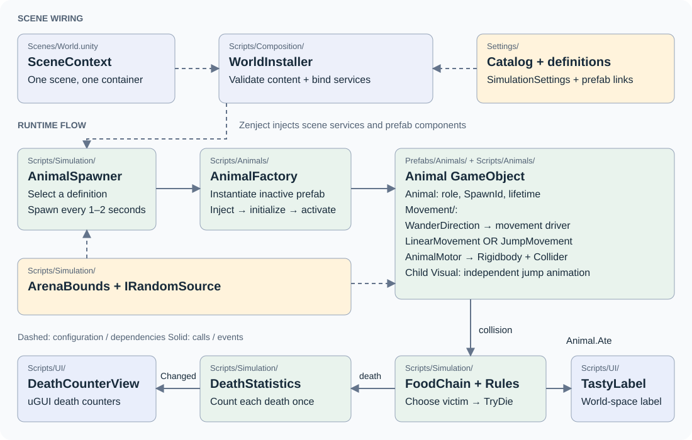

# Zoo World

A small top-down simulation: frogs jump, snakes roam and eat, and the HUD counts deaths. Built with GameObject components, Zenject and uGUI.

## Run

Open **`src/zoo-world`**, not the repository root, in **Unity 6000.3.6f1**. Wait for package import, open `Assets/ZooWorld/Scenes/World.unity` and press **Play**. The simulation runs automatically.

Tests: **Window → General → Test Runner**, then **Run All** in **EditMode** and **PlayMode**.

## Architecture

Paths below are relative to `src/zoo-world/Assets/ZooWorld`. The diagram shows scene wiring, runtime flow and the components of an animal.

To add a species, compose a prefab from `Animal`, `WanderDirection`, `AnimalMotor` and one movement component; create an `AnimalDefinition` and add it to `AnimalCatalog`. Food role and movement are independent; shared logic has no species-specific branches. Configuration is validated once by `Scripts/Composition/WorldInstaller` before simulation.

Regression tests live in `Tests/EditMode` and `Tests/PlayMode`.
